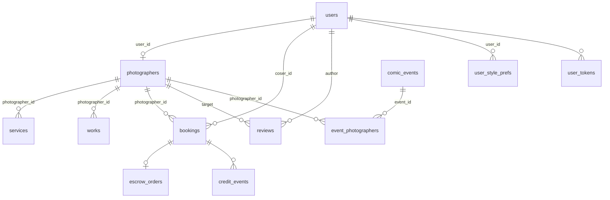

# 08 · 最终交接文档（Final Handoff）

> 生成时间：2026-11-22
> 对应代码：`master` @ `d962446`，`mp-build` @ `d8ee687`
> 前置文档：`01-quickstart.md` `02-architecture.md` `03-modules.md` `04-data-and-api.md` `05-dev-guide.md` `06-handover.md` `07-history.md`
> **本文档取代 `06-handover.md` 的「当前状态」部分**（06 的 §4.1 / §5 已过时，见 §12）。

---

## 1. 项目是什么

「米拉漫展」——漫展 × 摄影师约拍平台，双端：

| 端 | 技术 | 端口 | 生产路径 |
| --- | --- | --- | --- |
| C 端（coser / 摄影师） | uni-app (Vue 3 + TS) → H5 + 微信小程序 | H5 `5173` / MP 产物 `comic/dist/build/mp-weixin` | `https://glxy.haxlock.top` |
| 管理后台 | Vue 3 + Vite + Element Plus | `5174` | `https://glxy.haxlock.top/admin/` |
| API | Go 1.22 + Gin + pgx + sqlc | `8088` | `https://glxy.haxlock.top/api` |
| 数据库 | PostgreSQL 16 | `5433` | 容器内 |
| 缓存 | Redis 7 | `6380` | 容器内 |

仓库：`github.com/Maluslock/comic`（公开）。小程序 appid：`wxd46e40692ecd0173`。

规模（截至本文）：**33 个 C 端页面 / 80 条后端路由 / 44 个迁移 / 15 个 admin 模块 / 10 个定时任务**。

---

## 2. 目录结构

```
微信小程序开发/
├── comic/                        # 主仓库
│   ├── src/                      # uni-app C 端
│   │   ├── pages/                # 33 页
│   │   ├── components/           # MButton/MCard/MTag/MPriceTag/PhotographerCard/StylePicker/…
│   │   ├── stores/               # pinia: user / home / style / …
│   │   ├── api/                  # client.ts(拦截器) / index.ts(接口) / upload.ts
│   │   ├── utils/                # mappers(核心) / price / duration / preview / badge / nav
│   │   └── styles/tokens/        # 设计 token（唯一色值来源）
│   ├── server/                   # Go 后端
│   │   ├── cmd/api/              # API 主程序
│   │   ├── cmd/ingest/           # cron 调度器（读 config/cron.yaml）
│   │   ├── cmd/events-ingest/    # 漫展抓取一次性入口
│   │   ├── internal/{handler,service,repository,middleware,eventsource,cache,db}
│   │   ├── migrations/           # 000001 ~ 000044
│   │   └── static/               # 远程封面 remote/covers/*.webp + uploads/
│   ├── admin/                    # 管理后台
│   ├── doc/                      # 本文档所在
│   └── scripts/                  # optimize-covers.py / publish-mp-build.sh
├── .devenv/                      # 开发环境（pgdata/redis/logs/scripts）
├── .tools/                       # go 1.22.12 / home（trim-cli profile）/ node
├── .cache/                       # 本地编译的二进制（git 忽略）
├── .mp-build-repo/               # mp-build 分支的固定工作区（线性历史）
└── artifacts/mp-weixin/          # 小程序产物镜像（发布脚本读这里）
```

---

## 3. 环境与启动

### 3.1 开发容器（唯一环境）

容器名 `comic-dev-one`（`ubuntu 24.04`），挂载 `comic/ → /app`。

```bash
# 启动/重启（会重新 go build + 装依赖）
export HOME=/vol1/@appshare/fn-deepseek-harness/微信小程序开发/.tools/home
trim-cli --profile fnos docker container restart 7ce50593505e --yes

# 看进程
trim-cli --profile fnos docker container top 7ce50593505e

# 日志
tail -f .devenv/logs/api.log
tail -f .devenv/logs/cron.log
```

`restart` 后 `sh /scripts/one.sh` 会自动：`go build -o /tmp/api ./cmd/api` → `/tmp/ingest-cron -config config/cron.yaml` → `npm run dev:h5 --port 5173` → `pnpm dev --port 5174`。**约 10 秒 API 就绪**（不必等 60s）。

**坑**：`trim-cli` token 会过期，报 `failed to call HTTP proxy https://127.0.0.1:5667/ogh/ac/w` 时先 `trim-cli --profile fnos login --refresh`。token 失效期间容器可能被挂掉几十秒。

### 3.2 本地起后端（调试用，不碰容器）

```bash
export GOROOT=/vol1/@appshare/fn-deepseek-harness/微信小程序开发/.tools/go
export PATH="$GOROOT/bin:$PATH"
export GOCACHE=/tmp/gocache        # 默认 GOCACHE 是只读的，必须覆盖
export GOPROXY=off                 # 外网不稳，靠已有 GOMODCACHE
cd comic/server
go build -o ../.cache/dev-api ./cmd/api
SERVER_PORT=8094 ../.cache/dev-api
```

**三条硬规则（每条都踩过）**：

1. **必须 `cd server` 再启动**。从仓库根启动读不到 `.env` → 无 Redis、mock 登录被禁用、`/v1/tags` 直接 401。
2. **端口配置键是 `SERVER_PORT`，不是 `PORT`**。写错会去抢 `:8088` 报 `bind: address already in use`。
3. **二进制放持久目录**（`.cache/`）。`/tmp` 在两次 bash 调用之间会清空。

### 3.3 数据库 / 缓存

```bash
PGPASSWORD=comic123 psql -h 127.0.0.1 -p 5433 -U comic -d comic
# 库名是 comic，不是 comic_dev
```

### 3.4 mock 登录

`APP_ENV != "production"` 时开启。`code` 必须以 `1234` 开头（`auth_service.go:79` 判 `req.Code[:4]`），`123456` 可用。手机号后四位作昵称。

```bash
curl -X POST localhost:8088/api/v1/login \
  -H 'Content-Type: application/json' \
  -d '{"phone":"13000000001","code":"123456"}'
```

---

## 4. 数据模型（关键表）



| 表 | 说明 | 关键约束 |
| --- | --- | --- |
| `users` | 账号 | `style_pref_chosen`（000044）、`wx_openid`、`credit_score` |
| `photographers` | 摄影师档案 | `name_is_custom`（000043）、`mode ∈ {free,both,pay}`、`user_id` |
| `services` | 套餐 | `price_unit ∈ {fixed,per_photo}` + `photo_count`（000041）；聚合靠 `MIN(price) FILTER (WHERE price>0 AND price_unit='fixed')` 隔离，避免 ¥10/张 污染「¥399 起」 |
| `bookings` | 订单 | `service_id = 0` 是**互勉哨兵**（无 FK、无 CHECK，可落库）；`price_mode ∈ {fixed,per_photo,mutual,negotiable}` |
| `user_style_prefs` | 风格偏好关联表 | `(user_id, tag_id)` 唯一；与 `users.style_pref_chosen` **同事务**更新 |
| `escrow_*` | 担保交易四表 | 48h 默认裁决 |
| `comic_events` | 漫展 | 411 行 / 362 active；`cover_url` 指向 `/static/remote/covers/*.webp` |
| `event_photographers` | 漫展入驻 | 部分唯一索引 `ON (event_id, photographer_id) WHERE status <> 'rejected'` |
| `user_tokens` | 登录态 | **主键是 `token`，没有 id 列** |

迁移编号已到 `000044`，下一个是 `000045`。`down` 脚本普遍可回滚，但 `000042` 是刻意不可逆（`SELECT 1;`）。

---

## 5. API 面（80 条路由）

| 前缀 | 鉴权 | 说明 |
| --- | --- | --- |
| `POST /api/v1/login` | — | 手机号+mock code / 微信 code 换 token |
| `/api/v1/home` · `/cities` · `/tags` | — | 首页聚合 / 城市（73 个）/ 标签（**裸数组**，13 个） |
| `/api/v1/photographers*` | 部分 | 列表（`size` 参数，**没有 `limit`**）/ 详情 / 套餐 / 作品 / 评价 |
| `/api/v1/events*` | 部分 | 列表 / 详情 / 入驻申请 |
| `/api/v1/bookings*` | ✅ | 下单 / 列表 / 详情 / 取消 / 核销 / 交付 / 验收 / 争议 |
| `/api/v1/me*` | ✅ | 资料 / 头像 / 信用分 / **`style-prefs`** |
| `/api/v1/upload` · `/upload/base64` | ✅ | 双通道（小程序 uploadFile 白名单未配时的兜底） |
| `/api/admin/v1/*` | ✅ + role | 15 个模块：dashboard / user / photographer / order / event / event-source / event-apply / certification / content / banner / notification / dispute / audit-log / admin-accounts(super) |

**写接口的两个易错点**：

- `PUT /api/admin/v1/event-applications/:id/review` 的 body 是 `{"status":"approved"|"rejected","reason":"..."}`，**不是 `action`**。
- `/v1/photographers` 的分页参数是 `size`；`?limit=1` 会被忽略（返回默认 10/6 条）。

---

## 6. C 端页面（33）

**tabBar 4 个**：首页 / 摄影师 / 消息 / 我的。

| 分组 | 页面 |
| --- | --- |
| 首页与漫展 | index · event/list · event/detail · calendar |
| 搜索 | search（入口页）· search/result（结果页，支持 `keyword` / `tags` 双参数） |
| 摄影师 | photographer/list · detail · portfolio · activate · profile-edit · services · works · orders · cert-apply · event-apply |
| 交易 | booking · order/list · order/detail · comment |
| 社交 | chat · message · favorite/list · follow/list |
| 我的 | profile/index · profile/edit · profile/style-prefs · credit · settings/{index,doc,security,blocks} |
| 登录 | login（小程序端仅微信一键登录；H5 保留手机号） |

**关键约定**：

- 所有后端返回的图片路径**必须过 `resolveImage()`**（`src/utils/mappers.ts`）。它只处理 `/static/remote/**` 与 `/static/uploads/**` 两种前缀 → 补 origin；`/static/img/**`、`data:`、绝对 URL 原样返回。
- 导航统一走 `src/utils/nav.ts` 的 `navTo`（带 `animationType:'none'`），不要直接 `uni.navigateTo`。
- 页面根节点用 `.page` + `.scroll-content` 的 fixed + flex 高度链，**不要用 `min-height:100vh` + `height:100vh`**（会在真机被顶飞，见 §13）。

---

## 7. 管理后台（15 模块）

`admin/src/views/`：`_builtin`（布局）· dashboard · user · photographer · order · event · event-source · event-apply · certification · content · banner · notification · dispute · audit-log · admin-accounts。

- 路由 hash 模式，base `/admin/`。
- super 角色：`rolesOf()` 产出 `'super'`，`superOnlyRouteNames = ['admin-accounts']`。
- `.env` 必须 `VITE_AUTH_ROUTE_MODE=static`、`VITE_SERVICE_EXPIRED_TOKEN_CODES=401`，否则登录后被踢。
- 生产构建：容器内 `pnpm build`（`VITE_BASE_URL=/admin/`）→ 产物进 `server/admin-dist`，Gin `router.Static("/admin", ...)`；`/admin/assets/*` 走 immutable，其余 no-cache。

---

## 8. 定时任务（`server/config/cron.yaml`）

| 任务 | 频率 | 状态 |
| --- | --- | --- |
| `events-sync-morning` | `0 3 * * *` | ✅ |
| `events-sync-afternoon` | `0 15 * * *` | ✅ |
| `expire-cleanup` | `0 1 * * *` | ✅ |
| `booking-auto-cancel` | `*/30 * * * *` | ✅ |
| `booking-auto-accept` | `*/10 * * * *` | ✅ |
| `booking-noshow` | `0 * * * *` | ✅ |
| `booking-default-resolve` | `*/10 * * * *` | ✅ |
| `nyato-daily-full` | `0 3 * * *` | ❌ 源已死 |
| `nyato-afternoon-incremental` | `30 14 * * *` | ❌ 源已死 |
| `bilibili-sync` | `0 4 * * *` | ❌ 已并入 events-sync |

调度器入口是 `cmd/ingest -config config/cron.yaml`（**不是** `events-ingest -schedule`，那个只跑单表达式，曾导致其余 6 个任务从未执行）。启动日志首行应为 `cron scheduler started with 7 task(s)`。

漫展数据源：`allcpp`（必须带浏览器 UA，否则 403）+ `bilibili`（pagesize 上限 20，page≥2 会重复下发）。`nyato` 已 404。

---

## 9. 设计系统

色值唯一来源 `src/styles/tokens/*.scss`，`variables.scss` 只有旧别名（兼容 29 页历史代码）。

| Token | 值 | 用途 |
| --- | --- | --- |
| `$brand-primary` | `#FF6B00` | 主品牌橙 |
| `$brand-secondary` | `#00D2D3` | 次色青 |
| `$surface-page` | `#0c0d14` | 页面底 |
| `$surface-1` / `$dark-bg-card` | `#151722` | 卡片 |
| `$surface-2` | `#1D202F` | 封面占位 / 次级面 |
| `$text-3` | `#8A94A8` | 5.84:1（原 `#64748B` 只有 3.75:1） |

- 字阶 `20/24/28/32/36/44rpx`，间距 8pt 体系。
- `@keyframes` **必须写在 `global.scss`**，页面 scoped 里在小程序端可能失效。
- 封面一律 `<image>` + 三态（skeleton / `is-loaded` / `is-error`），**不要用 `background-image`**（小程序端没有 error 事件）。
- `@media (prefers-reduced-motion: reduce)` 只管关闭动画，**不能把动画包进去**（小程序 wxss 不解析该特性，包进去等于永不播放）。

---

## 10. 发布链路

### 10.1 代码（master）

```bash
cd comic
git add -A && git commit -m "feat(...): ..."
# push（GitHub 网络极不稳，必须循环重试 + ls-remote 校验）
B64=$(printf 'x-access-token:%s' "$GH_TOKEN" | base64 -w0)
git -c "http.https://github.com/.extraheader=Authorization: Basic $B64" \
    -c http.postBuffer=52428800 -c http.lowSpeedLimit=1000 -c http.lowSpeedTime=60 \
    push origin master
```

失败模式：`RPC failed; curl 16 Error in the HTTP2 framing layer` / `send-pack: unexpected disconnect` / `Operation too slow` / 443 超时。**实测平均第 3 次成功**，第 1、2 次必挂不是代码问题。

### 10.2 小程序产物（mp-build）

```bash
cd comic && npm run build:mp-weixin
rsync -a --delete --exclude '.git' --exclude 'README.md' \
      dist/build/mp-weixin/ ../artifacts/mp-weixin/
cd .. && bash scripts/publish-mp-build.sh
```

**两个坑**：

1. 发布脚本读的是 `artifacts/mp-weixin`，**不是** `comic/dist/build/mp-weixin`。不先 rsync 会报「产物无变化，跳过提交」。
2. 脚本用固定工作区 `.mp-build-repo` 做线性 commit。历史上曾在临时目录 `git init` 后强推 → 每次都是新根提交 → 用户 `git pull` 必报 `fatal: refusing to merge unrelated histories`。**已根治，别再改回临目录方式**。

Windows 侧拉包（慢网）：

```powershell
git fetch --depth=1 origin mp-build
git reset --hard FETCH_HEAD      # 只要 1.6M，省 90% 传输
```

### 10.3 后端上线

```bash
export HOME=/vol1/@appshare/fn-deepseek-harness/微信小程序开发/.tools/home
trim-cli --profile fnos docker container restart 7ce50593505e --yes
```

重启即重新 `go build`，无需手工构建。

---

## 11. 里程碑（按提交倒序，近 20 条）

| 提交 | 内容 |
| --- | --- |
| `d962446` | coser 首启风格偏好（`user_style_prefs` + StylePicker + 推荐按偏好取数） |
| `ecbd467` | 预约页 17:00 后默认选今天导致 8 时段全灰 |
| `7df3059` | 忽略 `.cache/` |
| `e47cdd7` | 互勉可预约（虚拟互勉套餐 + `serviceId=0` 哨兵） |
| `1b0f381` | 回滚 23 页无效的 `::before` 深色兜底（+8/−285） |
| `fded283` | 23 页补兜底层 + 日历/订单详情 fixed 高度链（后被 1b0f381 撤销） |
| `9c276e6` | 订单/漫展列表 fixed + flex，修 Android `calc(100vh - env() - 100rpx)` 整条失效 |
| `6c0ed72` | 白屏二轮：page-meta 根背景 + 删 uview 死引入（`app.wxss` 86KB→2.3KB） |
| `415b0d1` | 白屏三档治理：`navTo` 统一出口 + 8 页深色骨架 |
| `c523de9` | 统计行换行 / 头像链接残留 / 城市弹层无法滑动 |
| `73fd111` | 账号昵称单向同步到摄影师档案 + 艺名保护 |
| `0cc4214` | 微信头像昵称必填 |
| `654aa9e` | 头像上传双通道（multipart + base64） |
| `7ff8427` | 头像魔数识别 + 微信一次点击登录 + 头像双列同步 |
| `9f8d8a7` | 套餐按张计价 + 摄影师身份一致性 + 微信昵称采集 |

更早的里程碑见 `07-history.md`。

---

## 12. 已知缺口与技术债（按优先级）

### P1 · 上线合规 / 安全

1. **`WX_APP_SECRET` 与 DB 密码曾进公开仓库**（`server/.env.bak-*`、`server/api`），`4a2e98e` 已 `git rm --cached` + 补 `.gitignore`，**但历史未重写，凭证仍未轮换**。必须：微信后台重置 AppSecret → 更新 `server/.env` → 改 DB 密码 → 重启容器。
2. **小程序 `uploadFile` 合法域名未配**。`uni.uploadFile` 走独立的「uploadFile 合法域名」白名单，与 `request` 是两套。当前靠 base64 通道兜底，但大图会更慢。去 mp.weixin.qq.com 加 `https://glxy.haxlock.top`。
3. **`users.wx_openid` 全表为空** → 微信订阅消息一条都发不出去。需要**真机**微信登录一次（摄影师也要登一次）产生 openid。

### P2 · 功能未闭环

4. **支付未接**。`doc/review/payment-*.md` 已调研完：v3 无沙箱，mock 覆盖 80%，真钱验收集 0.01 元；商户号走 pay.weixin.qq.com 普通商户 + JSAPI（微信小店 / 购物订单 / 虚拟支付都不适用）。**用户决定后置**。
5. **escrow P1 未排期**：定金登记、争议举证附件。P0 已在线上（核销/交付/验收/争议/三个 cron）。
6. **聊天无 WebSocket**，目前是轮询。

### P3 · 工程卫生

7. `project.config.json` 源文件有 `enhance: true` 等 6 个键，产物里缺失 —— `uni.compiler.js:40-48` 硬编码模板不透传。`libVersion: ""` 同样需要手填。
8. `resolveImage()` 只认 `/static/remote/` 与 `/static/uploads/` 两前缀，后端新增静态目录会再现「图全黑」。建议改成前缀白名单或后端统一返绝对地址。
9. `/v1/tags` 与 `/v1/home` 的 `usageCount` 恒 0（`tags.usage_count` 全表 13 行从未维护）。
10. `06-handover.md` §4.1 / §5 已过时（认证图片、作品编辑、头像上传、super、操作日志、通知已读**都已完成**）。

---

## 13. 踩坑手册（每条都是真金白银）

### 前端 / 小程序

| 症状 | 真因 | 正确做法 |
| --- | --- | --- |
| 页面「糊」但 tabBar 清晰 | 设计稿用 px，rpx 换算后非整数倍 | 用 rpx + 整倍字号；模糊多在图片而非文字 |
| 顶栏滑到底再回顶消失 | `.scroll-content{height:100vh}` 是 content-box + 内联 `padding-top` → `docH=941` 可被 window 滚 97px，`.status-bar` 是 fixed 不跟随 | `.page{position:fixed;inset:0;flex column;overflow:hidden}` + `.scroll-content{flex:1;height:auto;min-height:0;box-sizing:border-box}`。**不要**用全局 `uni-page-wrapper{overflow:hidden}`（会裁掉靠 window 滚动的 `event/list`） |
| 键盘弹出把整页顶飞 | `<input>` 默认 `adjust-position` + `.page{min-height:100vh}` | `:adjust-position="false"` + `.page{height:100vh;overflow:hidden}` + 内容区 `flex:1;min-height:0` |
| 长会话输入栏彻底不可达 | 内容区缺 `min-height:0`（flex 子项默认 `min-height:auto`） | 所有 flex 滚动容器都要 `min-height:0` |
| `calc(12rpx + ...)` 在 H5 得到 0px | H5 里 rpx 不是合法 CSS 单位 | 用 `uni.upx2px()` 在 JS 里算 |
| 切页白屏（真机） | `navigateTo` 新建 webview 首帧默认白底，平台机制无接口控制 | 能做的只有：`animationType:'none'`、页面深色骨架、`page-meta root-background-color`、`app.wxss` 瘦身。**已做完，别再重开**（H5 逐帧 262 帧白帧 = 0） |
| 图片全黑（小程序，H5 正常） | 后端返相对路径，小程序无同源代理 → 当包内文件 404 → 露出近黑底色 | 一路 `resolveImage()`；封面用 `<image>` 三态而不是 `background-image` |
| `<image>` 明明 200 却看不见 | uni-app H5 里像素由内层 div 的 `background-image` 绘制，内层 `` opacity 恒 0；`.is-loaded` 没绑上就永远 opacity:0 | 判可见性看 uni-image 元素的 computed opacity，不看内层 img |
| 搜索关键词乱码 / 0 结果 | `getCurrentPages().options.keyword` 不解码（H5 框架自动解码所以看不出来） | `onLoad` + `decodeURIComponent` |
| 城市弹层滑不动 | `@touchmove.stop.prevent` 把内部滚动也阻止了 | 只 `.stop`，不 `.prevent` |
| tabBar 角标控制台报 `Uncaught (in promise)` | `uni.setTabBarBadge` 在非 tabBar 页走 fail 回调返回 rejected promise，try/catch 接不住 | 接收返回值后 `.catch(() => {})` |
| 上传失败但日志无请求 | 小程序 uploadFile 独立白名单，域名没配请求根本不发 | base64 通道兜底；正式解法是配域名 |
| `chooseAvatar` 临时路径无扩展名 | `wxfile://tmp_xxx` | 后端按**文件头魔数**识别（RIFF+WEBP / JPEG `FF D8 FF` / PNG 8 字节 / GIF） |
| 微信昵称拿不到 | `getUserProfile` 自 2022 起只返回「微信用户」 | 唯一合规路径是 `<input type="nickname">`（微信在原生键盘渲染「使用微信昵称」） |

### 后端

| 症状 | 真因 | 正确做法 |
| --- | --- | --- |
| 静态文件全 404 但内容明明是完整的 | gzip 中间件 `WriteHeader` 锁死首个 code，gin `createStaticHandler` 先试探性 `404` 再 `200` | `WriteHeader` 改「最后一次生效」+ 回归测试 |
| `GET /bookings/:id` 恒 500 | `p.avatar AS photographer_avatar` 遇 NULL 扫描失败 | `COALESCE(p.avatar, '')` |
| `SQLSTATE 42P08 inconsistent types deduced` | `$2` 同时出现在 `varchar` 与 `text` 上下文 | 显式 `$2::varchar` |
| `SQLSTATE 42883 operator does not exist: time < current_time` | `time` 是 varchar | 转 `::time` 或在 Go 侧比较 |
| `sqlc generate` 把新列吃掉 | `server/internal/db/query/*.sql` 没同步改 | 迁移 + query 文件必须成对改 |
| 缓存串号（同账号看到别人数据） | `cacheKey` 里塞了 viewer 维度，切碎缓存 | 列表缓存不含 viewer，结果里加 `IsSelf` 字段在出口后处理 |
| 空数组被当成「加载成功」永久锁死 | `loaded=true` 无条件置位 | 只在 `list.length > 0` 时置位 |
| 跨账号串写 | store 没在 logout/401 时 reset | `reset()` 挂 `client.ts` 401 分支 + `user.ts` `logout()`；跳过的 localStorage 键按 userId 隔离 |

### 团队 / 工具链

| 症状 | 真因 | 正确做法 |
| --- | --- | --- |
| `agent_teams_edit_plan` 报 `task has already started and cannot be edited` | 已 started 的卡契约不可改 | 只能改从未开始的 pending 卡；要改就跑完再重派，或新开一张等价卡 |
| 建卡依赖一张可能 FAIL 的卡 → 后续永远 claim 不到 | 调度器只认 `completed` 依赖 | 用 `edit_plan` 把 dependencies 清空，**不要**把 failed 粉饰成 completed |
| DSH 重启后团队 halt、任务全 cancelled | halt 会取消所有任务 | `agent_teams_resume` 只恢复调度器，**必须重建等价卡** |
| 成员模型与 plan 不符 | 运行时路由决定 | 以 `agent_teams_status` 实际显示为准 |
| `workbuddy/*` 成员唤醒失败 | 路由侧故障 | `deepseek-official/*` 正常，换 provider |
| 成员上下文超 262K | 网关上限 | 会在死循环，提前缩范围 |

### 验证方法论（最重要的一条）

> **凡是「兜底 / 保险 / 防御性」代码，必须先做 A/B 消除实验再决定留不留。**

反面教材：`fded283` 给 23 页加 `::before` 深色兜底层，313 行新增里 240 行（76%）是无用代码 —— `.page` 背景 100% 不透明且同色，`z-index:-1` 的伪元素被完全遮住。注入 `display:none` 后页面毫无变化。已经由 `1b0f381` 全删。

其它验证纪律：

- 声称「修好了」之前必须跑出证据：`vue-tsc --noEmit` + 双端 build + 产物断言 + 真浏览器实测。
- 验 TS 逻辑从 **dist 产物** require，不要硬抽源码（TS 类型注解会让 `new Function` 重建失败）。
- CDP 截图验可见性：`captureBeyondViewport:true` 会让视口外亮度测成 0 → 必须逐卡 `scrollIntoView` 后拍视口图。
- Web 验证登录注入四键缺一不可：`token` / `user` / `uni-storage-token` / `uni-storage-user`；`page.goto()` 后必须 `page.reload()` 才跑 `onLaunch`。
- 桩服务器（SimpleHTTP / 硬编码 JSON）冒充真接口 → 一律判 FAIL。

---

## 14. 验收基线

```sql
SELECT (SELECT count(*) FROM bookings)      || '|' ||
       (SELECT count(*) FROM services)      || '|' ||
       (SELECT count(*) FROM photographers) || '|' ||
       (SELECT count(*) FROM users);
-- 期望：23|22|6|18（bookings 的 +1 是 11-10 的互勉订单 #347，正常）
```

| 检查 | 期望 |
| --- | --- |
| `GET /api/v1/home` | 200 |
| `GET /api/v1/cities` | 200，`total = 73` |
| `GET /api/v1/tags` | 200，**裸数组**，`len = 13` |
| `GET /api/v1/photographers/5` | `serviceCount=0 hasFree=True services=[(0,'互勉约拍',0)]` |
| `GET /api/v1/photographers/1` | `mode=both serviceCount=4 hasFree=False minPrice=399`，无 `id=0` |
| `GET /me/style-prefs` 无 token | 401 |
| `POST /bookings {photographerId:5}` 不传 serviceId | 201 `priceMode=mutual` |
| `POST /bookings {photographerId:1, serviceId:0}` | **404**（0 元白嫖红线） |
| `serviceId: -1` | 400 `invalid service id` |
| `dist/build/mp-weixin` | 1.6M / 242 文件 / 单文件 >200k 为 0 |

---

## 15. 下一步建议（按性价比排序）

1. **轮换凭证**（P1-1）。半小时的事，风险最高。
2. **配 uploadFile 域名 + 真机登录一次**（P1-2 / P1-3）。打通订阅消息，这条链一断所有通知都是死的。
3. **`resolveImage` 前缀白名单**（P3-8）。半小时，防止下次加静态目录再全黑。
4. **`usageCount` 维护**（P3-9）。让热门标签排序有依据。
5. **支付**（P2-4）。要真钱，先想清楚商户资质与退款流程。
6. **escrow P1**（P2-5）。有争议场景再补，没量之前不急。
