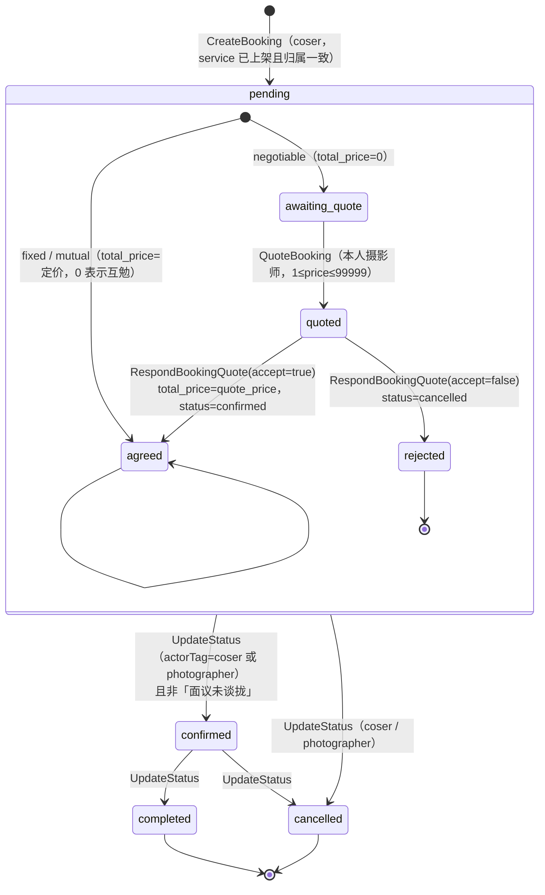
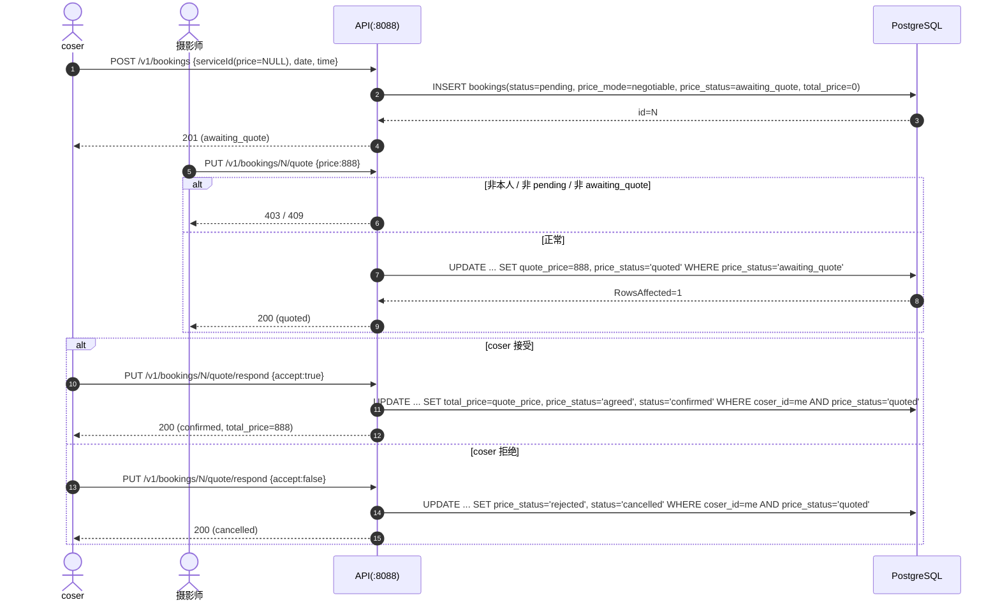

# 预约 / 订单状态机（评审参照物）

> 只描述**代码实际行为**。行号对应 `master` 当前提交。
> 相关实现：`server/internal/service/booking_service.go`、`server/internal/db/query/bookings.sql`、
> `server/internal/repository/bookings.sql.go`、`server/migrations/000029_bookings_slot_unique.up.sql`。

## 1. 字段含义

| 字段 | 取值 | 写入点 |
|---|---|---|
| `status` | `pending` / `confirmed` / `completed` / `cancelled` | `CreateBooking` 写 `pending`；`UpdateBookingStatus`、`AcceptBookingQuote`、`RejectBookingQuote` 改 |
| `price_mode` | `fixed` / `mutual` / `negotiable` | `booking_service.go:206-222`：`price > 0` → fixed；`price = 0` → mutual；`price IS NULL` → negotiable |
| `price_status` | `agreed` / `awaiting_quote` / `quoted` / `rejected` | fixed、mutual 创建即 `agreed`；negotiable 创建 `awaiting_quote`；报价后 `quoted`；接受 → `agreed`；拒绝 → `rejected` |
| `total_price` | int32，NOT NULL | 创建时取套餐价（面议/互勉写 0）；接受报价时 `= quote_price` |
| `quote_price` | int32，可空 | 仅 `QuoteBooking` 写入，单轮，不覆盖（`price_status='awaiting_quote'` 才生效） |

## 2. 状态机

要点：

- `canTransition`（`booking_service.go:76-86`）只允许 `pending→confirmed|cancelled`、`confirmed→completed|cancelled`；其余一律 `ErrInvalidTransition`（409）。
- 面议单在 `price_status != 'agreed'` 时**任何角色**（含 admin）都不能置 `confirmed`（`booking_service.go:334-337`、`404-407`）。
- `ActorTag` 缺省为 `"coser"`（`booking_handler.go:73-75`），未知取值 → `ErrForbidden`（`booking_service.go:326-329`）。

## 3. 面议单时序

## 4. 状态 × 角色 × 动作矩阵

| 当前状态 | coser 可见/可做 | 摄影师可见/可做 | 后端约束入口 |
|---|---|---|---|
| `pending`（fixed / mutual） | 取消（`cancelled`）、确认（`confirmed`，**当前也允许**）、联系 | 确认、取消、联系（号码可用） | `UpdateStatus` + `canTransition` |
| `pending`（negotiable, `awaiting_quote`） | 取消、等待报价 | 报价（`quote`）、取消 | `Quote` 要求 `price_status='awaiting_quote'` |
| `pending`（negotiable, `quoted`） | 接受 / 拒绝报价、取消 | 不能二次报价（RowsAffected=0 → 409） | `RespondQuote`（仅 coser） |
| `confirmed` | 取消、完成（`completed`）、联系 | 完成、取消、联系 | `canTransition` |
| `completed` | 评价（`HasCompletedBookingWith` 校验）、联系 | 联系 | `review_service` |
| `cancelled` | 无可用动作（时段释放） | — | 终态 |

## 5. 图与代码不一致 / 已发现风险（供 t1~t4 复核）

| # | 现象 | 位置 | 说明 |
|---|---|---|---|
| S1 | 接受报价的 SQL **不带 `status='pending'` 守卫**，只判 `price_status='quoted'` | `repository/bookings.sql.go:255-258`（`acceptBookingQuote`） | Go 层先读 `b.Status != "pending"` 拦（`booking_service.go:462-464`），但读与写之间若被 admin 取消，`WHERE price_status='quoted'` 仍成立 → 已取消订单可被「复活」为 confirmed。属于 TOCTOU 级联，非纯理论。 |
| S2 | 报价/接受/拒绝**不发通知、不重算统计** | `booking_service.go:420-480` | `UpdateStatus` 里有 `notify` + `recomputeStats`，`Quote` / `RespondQuote` 全无；接受报价直接改 `status=confirmed` 绕过了通知路径。 |
| S3 | coser 可自行把 `pending` 置 `confirmed`（fixed/mutual） | `booking_service.go:311-323` | `UpdateStatus` 只校验「是这单的 coser」，不校验动作语义；等于客户自己接单。是否设计如此需 t1 判定。 |
| S4 | 拒绝报价后 `price_status='rejected'` 且 `status='cancelled'`，无重新报价/重开路径 | `repository/bookings.sql.go:262` | 只能重新下单；`rejected` 是死状态。 |
| S5 | `total_price=0` 同时表示「互勉」和「面议未定」 | `booking_service.go:208-216` | 只能靠 `price_status` 区分；任何只用 `total_price` 做判断的新代码都会算错。 |
| S6 | `isPastSlot` 用服务器本地时区，时刻解析失败退化为「只比日期」 | `booking_service.go:90-110` | 服务器时区若为 UTC，东八区 00:00-08:00 的「今天」会被判成过去/未来错位；非法时刻字符串会被放行。 |
| S7 | 时段唯一索引是 `(photographer_id, date, time) WHERE status <> 'cancelled'` | `migrations/000029` | 覆盖所有写路径；但「同一 coser 同时段下两单给不同摄影师」不受限（业务上可能合理，需确认）。 |

## 6. 环境

- API：`http://localhost:8088/api/v1`（线上 `https://glxy.haxlock.top/api/v1`）
- DB：`psql -h 127.0.0.1 -p 5433 -U comic -d comic`，口令 `comic123`
- 账号：coser `13000000001` / `13000000002`，摄影师 `10000000001`~`04`，验证码均 `123456`
