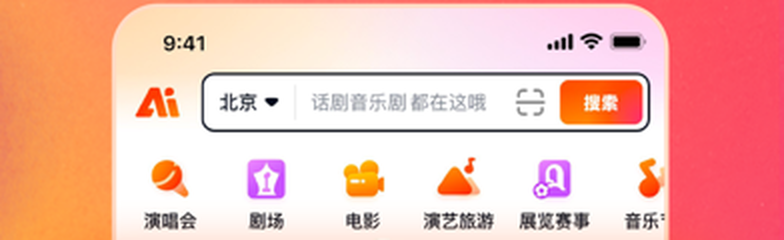
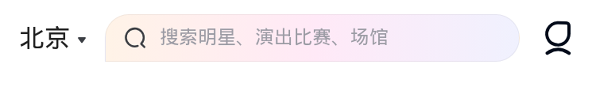
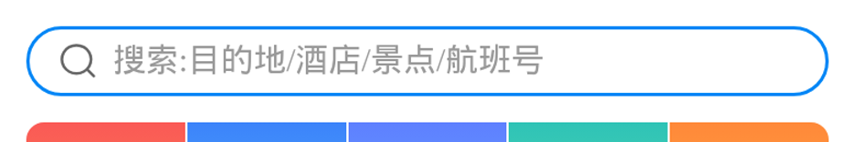
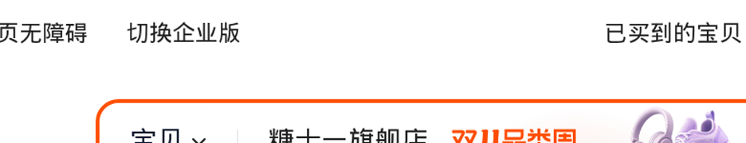

# 首页 hero 顶栏调研：主流平台把「搜索」和「消息通知」放在哪、怎么避让微信胶囊

- 调研目的：为首页 hero 顶栏改版提供业界依据。当前实现是**城市胶囊独占第一行 / 搜索 + 铃铛被推到第二行贴右**，用户判定「仍难看」；需要判断这是实现细节没调好，还是**结构本身就没有先例**。
- 调研对象：小红书、闲鱼、大众点评、美团、大麦、猫眼、携程、得物、淘宝（9 个，超出要求的 6 个）。
- 取证方式：App Store 官方截图（逐张放大读顶栏）+ 各家 H5 真实抓图（headless Chromium 155，390×844@2x）+ 官方设计文档原文核对。**所有结论都来自读图，不是推测**；凡没能拿到可读截图的，一律标弱证据。
- 取证时间：2026-11-02。App 版本：小红书 9.52 / 闲鱼 7.28.80 / 大众点评 11.74.2 / 美团 12.68.201 / 大麦 9.0.37 / 猫眼 9.83.1 / 携程 8.97.2 / 得物 6.3.7 / 淘宝 10.68.10。
- 范围：**只调研，不改代码**。视觉方案与实现属后续任务，本文只给事实、约束和尺寸账。

---

## 一、结论先行

1. **没有一家把「城市/定位」做成独占一行的胶囊。** 9 个平台里，城市只有三种归宿：① 缩成搜索框左端一小段文字（大麦 H5、猫眼）；② 并进搜索框内部当分段（大麦 App「北京 ▾ | 搜索」、淘宝「宝贝 ▾ | 关键词」）；③ 顶栏里根本没有城市（得物、携程、闲鱼、小红书、大众点评把它放在 tab 行而非搜索行）。**当前实现的根因不是间距没调，而是「城市胶囊独占第一行」这个结构在业界找不到对应物。**
2. **主流的最优解是「一行三件」：城市（纯文字或框内分段）→ 搜索（`flex:1` 吃满剩余宽度）→ 右侧至多一个东西。** 胶囊区不是「留一条白」，而是被搜索框的右端**自然吃掉**——搜索框越宽，右边的空白越少，胶囊看起来越像整体设计的一部分，而不是被躲开的障碍。
3. **消息通知的主流归属是底部 tabBar（或「我的」），不是顶栏那一行。** 9 个平台的分布：**底部 tabBar 5 家**（大众点评、猫眼、闲鱼、携程、小红书）、**收进「我的」体系 1 家**（得物）、**独立悬浮图标列 1 家**（淘宝，不在搜索框同一水平线）、**顶栏同行 1 家**（大麦，且它没有底栏）、**未见顶栏消息入口 1 家**（美团，右上角是耳机客服）。→ **只有大麦一家把消息图标和搜索框放在同一条水平线上，前提是它压根没有底部 tabBar。** 没有任何一家把铃铛推到搜索框的**下一行**贴右——那是最不像任何产品的做法。
4. **顶栏右侧只允许一个元素。** 因为微信胶囊（典型 87×32px、右边距 7px）会把顶栏右端切掉约 1/4 屏宽，`375 − 16(左留白) − 7 − 87 ≈ 265px` 就是胶囊行上真正可用的宽度。这一行塞不下「城市胶囊 + 搜索框 + 两个圆钮」四件东西——这正是当前实现被挤到第二行的物理原因。
5. **胶囊避让在业界只有四种做法**（见第四节），其中「搜索框右边界顶到胶囊左侧」是绝对主流（6/9）；「整条留白」是唯一没有任何产品采用的。
6. **本项目早就有正确方向**：`comic/doc/home-hero-redesign.md` 的目标结构写的就是「城市胶囊 + 搜索胶囊(flex:1) + 通知」。本次调研从外部印证了它，并给出尺寸账（第六节 6.3）。

---

## 二、逐平台要点

### 证据等级

| 级别 | 含义 | 可信度 |
|---|---|---|
| **A** | 真实 App 界面截图（App Store 官方截图里拍到完整界面，逐张放大读图） | 高，可直接照抄尺寸关系 |
| **B** | 各家 H5 首页真实抓图（headless Chromium，390×844@2x） | 高，但 H5 与 App 顶栏偶有差异 |
| **C** | 营销图/宣传截图的局部 | 中，只能证明「有这个元素」，不能证明精确宽度 |
| **D** | 官方设计文档原文 | 最高，约束性引用 |

---

### 1. 大麦 —— 最值得抄的正面样板（两路证据互相印证）




- **App 形态（A）**：单行。最左是橙色 `Ai` logo → 紧接一条**黑描边的白底搜索条**，条内从左到右是「北京 ▾」城市 + 竖分隔线 + placeholder「话剧音乐剧 都在这哦」+ 中间扫码图标 + **最右橙色「搜索」按钮**。搜索条右侧**一个像素都不剩**，胶囊区完全被搜索条右端吃掉。下一行才是 6 个圆形品类入口。
- **H5 形态（B）**：另一种排法，同样单行 —— 左「北京 ▾」**纯文字、无底色无边框** → 中间浅紫粉渐变药丸**假搜索框**（左放大镜 + 「搜索明星、演出比赛、场馆」），`flex:1` 占满剩余宽度 → **最右一个独立圆形描边图标**（客服/消息气泡），与搜索框在同一条水平线上。
- 两种形态给出同一个结论：**「城市不占独立一行 + 搜索吃满 + 右端只留一个东西」是成立的**，且手机端 App 与 H5 都能实现。
- 注意：大麦 H5 底部**没有 tabBar**（是内容流），所以它必须把消息留在顶栏——这是它和其他平台不同的原因，也是「顶栏放消息」只在**没有底栏**时才必要时才出现的旁证。

来源：[App Store 大麦](https://apps.apple.com/cn/app/id513829338) ｜ H5 [m.damai.cn](https://m.damai.cn/)

---

### 2. 大众点评 —— 反面参照：城市在 tab 行、搜索独占下一行（A）


- 顶部第一行是「关注 / **上海 ▾** / 附近 / 品质外卖 / 热点」的**文字 tab 行**，右端只有一个「NEW」角标；**没有搜索框、没有铃铛**。
- 第二行才是白底圆角**假搜索框**：左「扫一扫」图标 + 关键词示意 + 右橙色「搜索」按钮。
- 消息彻底下沉到底部 tabBar（第一栏「首页 / 视频 / ＋ / 消息(66) / 我的」，红底白字 66 角标）。
- 它能这么做的前提是**第一行有 5 个文字 tab 要放**——那条行本来就被导航占满了，胶囊只是「没人抢」。**我们第一行只有一个城市胶囊，没有理由占满整行。**

来源：[App Store 大众点评](https://apps.apple.com/cn/app/id351091731) ｜ H5 [m.dianping.com](https://m.dianping.com/)

---

### 3. 猫眼 —— 「城市 + 搜索」单行、消息进底栏（A）


- 顶栏单行：左「北京 ▾」纯文字，右接白底搜索框（框内含热搜词 + 最右红色「搜索」胶囊按钮）。**无 logo、无消息图标。**
- 消息在底部 tabBar。
- 猫眼和大众点评同属「买票」类目，但猫眼选择把整行让给搜索、消息完全不进顶栏 —— **同赛道的两个产品都证明：搜索优先级高于消息，顶栏那一行是搜索的。**
- 它的 H5 是「猫眼电影 logo + 城市 ▾ + 首页/电影/影院」的**网页版导航**，与 App 布局不同，取证时不能混用。

来源：[App Store 猫眼](https://apps.apple.com/cn/app/id504274740) ｜ H5 [maoyan.com](https://www.maoyan.com/)

---

### 4. 得物 —— 搜索独占整行、零右侧图标（A）


- 顶栏是**整条浅灰假搜索框**：左放大镜 + placeholder「低帮脏脏鞋」，框内右端是「相机/扫一扫图标 + 竖分隔线 + 搜索文字」。左右各留窄边距，**吃满整行**。
- **没有城市控件**（城市/收货地址不在顶栏），**也没有任何消息铃铛**（消息在「我的」体系里）。
- 这是最「激进」的一种：顶栏只有搜索一个元素，连 logo 都不要。当一个产品的核心动线就是「搜商品」时，这是最干净的解法。
- 得物顶栏空间紧到什么程度，可以从旁证看：它连原本静态展示的产品名都要改成**品牌动态文字轮播**来腾位置（优设分析文）。[优设：得物顶部标题栏品牌轮播](https://www.uisdc.com/hunter/0221629292.html)

来源：[App Store 得物](https://apps.apple.com/cn/app/id1012871328)

---

### 5. 闲鱼 —— 搜索独占一行 + 功能图标成簇（A）


- 典型形态：「‹ 闲鱼回收」返回行 → 下一行右边挂 3 个功能图标 + `…`（更多）→ **再下一行整条白底假搜索框**（「热门回收：iPhone 15 Pro Max」）。
- 另一种形态：「‹ 🙂 神奇的闲鱼 …」导航行 → 下一行是「宝贝 234 / 闲鱼空间 / 评价 / 动态 / 🔍」的 tab 行，**搜索退化成最右一个放大镜**。
- 底部 5 tab（闲鱼 / 会玩 / 中间「卖闲置」/ 消息 / 我的），**消息在底栏**。
- 闲鱼给出的启发是「**图标可以成簇**」：右侧要么放一簇图标、要么放一个搜索框，**不混排**。

来源：[App Store 闲鱼](https://apps.apple.com/cn/app/id510909506)

---

### 6. 携程 —— 顶栏整条就是搜索框，消息进底栏（B）



- H5 首页顶部**整条就是搜索框**：蓝描边药丸、左放大镜、文案「搜索:目的地/酒店/景点/航班号」，左右各留 16px。
- **顶栏没有任何城市控件**——城市被降级为「搜索意图的一部分」（用户搜的就是目的地）。
- 底部 4 tab：首页 / 社区 / 消息 / 我的。消息在底栏。
- 携程是「**搜索即顶栏**」的极致：连城市这个词都不出现。

来源：H5 [m.ctrip.com](https://m.ctrip.com/) ｜ [App Store 携程](https://apps.apple.com/cn/app/id379395415)

---

### 7. 淘宝 —— 搜索吃满 + 图标另立一列（B）



- 顶部整条橙描边胶囊搜索框（框内左端「宝贝 ▾」品类选择 + 长尾词 + 双 11 标记），吃满整行。
- 搜索框**右侧外挂一列竖排悬浮图标**（淘/消息气泡/购物车/客服等），贴屏幕右边缘约 12px，纵向从搜索框高度往下延伸。
- 淘宝证明「图标也可以不跟搜索同一条水平线，而是**另立一列压在内容上**」——但这需要 `z-index` 分层和热区隔离，且那列图标在滚动时会遮挡内容，属于重成本方案。
- 注意：`taobao_0.jpg` 这类 App Store 营销图顶部只有双 11 活动海报，**不能当布局证据**（本次已踩坑）。

来源：H5 [main.m.taobao.com](https://main.m.taobao.com/) ｜ [App Store 淘宝](https://apps.apple.com/cn/app/id387682726)

---

### 8. 小红书 —— 顶栏放消息，但代价是搜索降级成图标（A）


- 顶栏是**对称三段**：左「通知/私信」图标 → 中间「关注 / 发现 / 附近」分段 tab → 右「🔍 放大镜」图标。
- **没有搜索框**，搜索退化成一个图标（点进搜索页）。这是「顶栏放消息」必须付的代价：右侧只剩**一个**位置，它被分给了搜索。
- 底部 tabBar「首页 / 市集 / ＋ / 消息 / 我」——**消息其实在底栏也有一份**，顶栏那个是「通知/私信」的快捷入口，属于**双重曝光**。
- 小红书对我们的价值：它证明了「顶栏放一个消息图标 + 右侧只放一个搜索图标」**是能看的**，但前提是中间有「关注/发现/附近」分段 tab 把空间填满；如果中间是空的，就退化成「两个图标孤零零漂在右上角」——这正是当前实现的观感。
- 注意它和大麦的区别：大麦是**没有底栏**才把消息放顶栏，小红书是**有底栏仍然放**（属于运营强推），两者都不是「因为顶栏空着所以放一个铃铛」。

来源：[App Store 小红书](https://apps.apple.com/cn/app/id741292507)

---

### 9. 美团 —— 证据不足，只作弱参照（C）

- 可得的 App Store 营销图顶部条基本是纯色渐变海报（只拍到「本图仅为示例」一类宣传文字），**没能拍到真实 App 顶栏**。
- 历史读图结论（弱）：单行「‹ 闪购 | 定位 望京恒电大厦 ▾ + 右上 ···」，**下一行才是假搜索框 + 右侧「搜索」按钮**；外卖版右上角放耳机客服图标。
- 也就是说美团属于「**搜索独占第二行**」的类型（和大众点评同族），城市在搜索**上一行**但与返回/更多图标同行，仍然**不独占整行**。
- 本文对美团不作强结论，仅作为「城市 + 搜索可以分两行」的旁证，且它上一行还有返回键和 `···` 填充——**不是空白**。

来源：[App Store 美团](https://apps.apple.com/cn/app/id423084029)

---

## 三、横向对比表

| 平台 | 搜索形态 | 消息位置 | 胶囊处理 | 结论 | 证据 |
|---|---|---|---|---|---|
| **大麦** | 假搜索框（药丸，`flex:1`），App 版把「北京 ▾」放进框内左端 | **顶栏最右**一个客服/消息圆钮（与搜索同行）；底栏无 tabBar | 搜索框右边界顶到胶囊左侧，右端只留一个元素 | ✅ **最推荐抄**：城市不独占行 + 搜索吃满 + 右端只有一个 | A+B |
| **大众点评** | 假搜索框独占第二行（框内左「扫一扫」+ 右「搜索」按钮） | 底部 tabBar（消息带数字角标 66） | 第一行被 5 个文字 tab 占满，胶囊下方自然无内容 | ⚠️ 抄不了结构（我们没有 5 个 tab），可抄「消息进底栏」 | A |
| **猫眼** | 「北京 ▾」纯文字 + 假搜索框 + 红色搜索按钮，一行 | 底部 tabBar | 搜索框右端 = 胶囊左侧，无第二个元素 | ✅ 可抄：城市纯文字化 + 搜索吃满 | A |
| **得物** | **整条**假搜索框（框内右端 扫码 + 搜索），顶栏只有它 | 不在顶栏（「我的」体系） | 搜索框左右留窄边距吃满整行，胶囊区由框吃掉 | ✅ 可抄「搜索吃满」；❌ 不可抄「无城市」（我们需要城市） | A |
| **闲鱼** | 整条假搜索框，独占一行；或退化为最右放大镜 | 底部 tabBar | 右侧图标**成簇**（3 个 + ···）与搜索不同行 | ⚠️ 图标成簇可抄，其余不适用 | A |
| **携程** | **顶栏整条就是搜索框**（无城市控件） | 底部 tabBar（首页/社区/消息/我的） | 搜索框左右各留 16px 吃满，胶囊区被吞 | ⚠️ 「城市并入搜索意图」可借鉴，但我们是城市选择器有独立业务 | B |
| **淘宝** | 整条胶囊搜索框（框内左端「宝贝 ▾」品类） | 不在顶栏 | 搜索吃满 + 右侧**另立一列**竖排悬浮图标 | ❌ 不建议抄（需 z-index 分层、遮挡内容、热区难隔离） | B |
| **小红书** | **无搜索框**，右上放大镜图标 | **顶栏左侧**通知/私信图标 + 底栏「消息」双重曝光 | 左图标 + 中间分段 tab + 右图标，胶囊下方正好一个图标 | ⚠️ 「顶栏放消息」可行，但代价是搜索降级 + 中间必须有 tab 填充 | A |
| **美团** | 假搜索框独占第二行 + 右侧「搜索」按钮 | 不在顶栏（右上为耳机客服） | 上一行有返回键/定位/···填充，非空白 | ⚠️ 弱证据，仅作旁证 | C |
| **（本项目现状）** | 两个 64rpx 圆形图标（搜索 + 铃铛），**无搜索框** | 顶栏第二行最右，带 badge | **第一行整条留白**给胶囊，图标落第二行 | ❌ 业界 0 对应物：既不是小红书式对称（中间无内容），也不是大麦式吃满（无搜索框） | — |

---

## 四、胶囊避让：业界真实的四种做法

| 做法 | 说明 | 采用者 | 适用条件 |
|---|---|---|---|
| **① 搜索框右边界顶到胶囊左侧** | 搜索框 `flex:1`，容器 `padding-right` = 胶囊宽度 + 右边距；胶囊行上除了搜索框右端那一个元素，不放别的 | 大麦、猫眼、得物、携程、闲鱼、美团 | **需要有一个 `flex:1` 的搜索框来吸收宽度**。如果没有，右侧就会撑出一条空白 |
| **② 搜索吃满 + 图标另立一列** | 搜索框吃满整行，图标竖排悬浮在右上，压在内容层上 | 淘宝 | 需要 z-index 分层 + 图标列不参与布局；滚动时会遮挡内容 |
| **③ 左右对称 + 中间填满** | 左图标 / 中间分段 tab / 右图标，胶囊下方正好落一个图标 | 小红书 | 中间必须有分段 tab（关注/发现/附近）把空间填满；否则两个图标会「漂」 |
| **④ 整条留白（纵向让位）** | 第一行只放一个元素，用 min-height 把胶囊整条高度让出来，其余内容推到下一行 | **无（本项目独有）** | 只有在第一行本来就有多个 tab 时才显得自然（大众点评）；第一行只有一个胶囊时，视觉上是「左边一个小药丸 + 右边一大片空」 |

**结论：做法 ① 是唯一既有主流支持、又不需要额外分层成本的方案。它的关键不是「让多少」，而是「让出去的宽度由谁吸收」——由搜索框吸收，而不是留白。**

---

## 五、反面案例 / 常见坑（三条硬的 + 一条附赠）

### 坑 1：用 `padding-right` 把整段让给胶囊 → 图标被挤到屏幕左侧 1/3

- 现象：`padding-right = capsuleInset`（胶囊宽 + 右边距 ≈ 94px）作用在整行上，行内元素全部左移。在 375px 屏上，可用宽度从 343px 掉到 **249px**；如果这一行只有两个 32px 的圆钮且 `justify-content: flex-start`，它们就停在 x≈16~96px，即**屏幕左侧 1/3**。
- 本项目踩过：`comic/src/pages/index/index.vue:38-42` 的注释原文就是"之前靠 `paddingRight=capsuleInset` 把右侧整段让给胶囊，两个图标就被推到屏幕左侧 1/3，既不平衡也难看"。
- 正确修法不是「把图标挪到下一行」，而是**在这一行放一个 `flex:1` 的搜索框去把那 94px 吃掉**。业界没有一家靠把元素挪走来解决这个问题。

### 坑 2：热区 <44pt，或热区外扩后互相重叠

- 现状：`.city-selector` 与 `.hero-icon-btn` 的视觉高度都是 **64rpx ≈ 32px**（`comic/src/pages/index/index.vue:564`、`index.vue:626`），靠 `::after` 全向外扩 14rpx（≈7px）补到 46px（`index.vue:578`、`index.vue:641`）。
- **数值本身刚好达标，但它是「靠外扩撑出来的虚胖热区」**，有两个隐患：
  1. 两个圆钮之间是 `gap: 28rpx`（14px），两边各外扩 7px，**热区边缘正好相切**（`index.vue:618`）。任何人把 gap 调到 24rpx 以下，就会出现「点搜索点到铃铛」——而微信官方原文点名要防的正是这件事：「若需要在此区域附近放置可交互元素，要特别注意交互事件是否会冲突」（[微信小程序设计指南](https://developers.weixin.qq.com/miniprogram/design/) 2.1）。
  2. 一旦搜索变成一个 `flex:1` 的搜索框，圆钮的外扩层会**侵入搜索框的点击区**。微信适老化指南 3.3 明确：「交互元素处于容器中（如导航栏、卡片、cell），**则最大热区不超过容器本身**」「避免交互元素过于拥挤，元素间的视觉距离至少为 2A」（[微信小程序适老化设计指南](https://developers.weixin.qq.com/miniprogram/design/elderly.html) 3.3）。→ 改成搜索框后，**热区要改成靠视觉尺寸达标（≥88rpx），而不是靠 `::after` 外扩**。
- 官方底线两处可引：微信设计指南 3.2「可点击像素尺寸……换算成物理尺寸后大致是在 **7mm-9mm** 之间」；适老化 3.3「较大尺寸（**至少 ≥44pt**）且有清晰边界的元素不必增加热区」「特殊的小尺寸元素……以保证最少 40×40pt 热区」。

### 坑 3：胶囊右侧整条留白 → 视觉空洞 + 垂直空间被白吃 + 下方内容被裁

- **视觉空洞**：第一行只有左侧一个城市药丸（`height: 64rpx` + `padding: 0 22rpx` + 内容约 98rpx，合计 ≈**144rpx ≈ 72px**，随城市名字数浮动到 ≈170rpx），右边界停在 x≈88px；而内容区右边缘在 x≈359px（`padding: 24rpx 32rpx 0` 对 375px 屏）。→ 第一行右侧有**约 270px 连续空白，是城市药丸宽度的约 3.8 倍**。这比「图标被挤到左边」更难看，因为空白压在首屏最显眼的右上角。
- **垂直浪费**：`capsuleRowHeight = Math.max(capsuleBottom + 8, 32)`（`comic/src/pages/index/index.vue:258`）把胶囊底边高度整条让出来，约 40px；再加第二行 32px + `margin-top: 8rpx`，顶栏实际占掉首屏 **≈80px**，而内容只有两个小图标。首屏 820rpx（≈410px）的 hero 区（`.hero-stage`，`index.vue:502-507`）被顶栏吃掉近 1/5。
- **内容被裁**：`.hero-stage` 是 `height: 820rpx` + `overflow: hidden`（`index.vue:504-505`），`.hero-content` 是 `flex-direction: column` + `padding: 24rpx 32rpx 0`，而 `.hero-copy` 靠 `margin-top: auto` + `padding-bottom: 116rpx`（`index.vue:681-684`）顶到下方。**顶栏每多占 1px，就 1:1 从 hero-copy 的可视高度里扣 1px**；一旦 `.hero-stage` 高度不够或胶囊行异常变高，被裁的就是 CTA 区域。

### 坑 4（附赠）：`getMenuButtonBoundingClientRect` 首帧返回全 0 → 两端高度不一致

- 现状已有兜底：`updateCapsuleBottom()` 取不到时置 0（`comic/src/pages/index/index.vue:303-316`），并在 `onShow` / `onReady` / `onMounted` 各调一次（`index.vue:318/323/327`）。
- 但兜底后 `capsuleRowHeight` 退化为 **32px**，而微信端是 ≈40px —— **同一条顶栏在小程序里和 H5 预览里高度不同**，用 H5 验收会在真机上差 8px。改造后如果仍要保留纵向让位，这个常量必须显式写死为设计值，不能靠 0 兜底。

---

## 六、可抄 / 抄不了

### 6.1 可抄（有实测依据、成本可控）

1. **搜索占满胶囊左侧的全部剩余宽度（`flex:1`），右侧至多留一个元素。** 大麦（A+B）、猫眼（A）、得物（A）、携程（B）、闲鱼（A）、美团（C）六家一致，是本次调研最强的共识。至于城市放在哪，有两种落地：**(a) 搜索框外的纯文字城市**（大麦 H5、猫眼，一行三件）或 **(b) 城市并进搜索框左端**（大麦 App、淘宝，一行两件）。
2. **搜索做成「假搜索框」而不是图标。** 9 家里 **8 家是假搜索框**（大麦、大众点评、猫眼、得物、闲鱼、携程、淘宝、美团），只有小红书是纯图标——而它有「关注/发现/附近」分段 tab 填充，换成我们没有。假搜索框自带"占位宽度"，正是吸收胶囊让出的 94px 的那块料。
3. **城市降级：从「64rpx 有底色胶囊」降到「纯文字 + ▾」。** 大麦 H5、猫眼都是纯文字；单这一步就能省出约 **20–25px** 宽度（带壳城市 ≈144rpx≈72px vs 纯文字内容 ≈98rpx≈49px，省下的是 `padding: 0 22rpx` 的 44rpx 与 1rpx 边框）。
4. **更激进但更接近大麦 App 的做法：城市并进搜索框左端**（框内「北京 ▾」+ 竖分隔线 + placeholder）。此时顶栏只有**一个**元素，整行 343px 全给搜索框，胶囊区被彻底吃掉，视觉上最干净。
5. **消息通知改由底部 tabBar 承担。** 9 家里 **8 家不让消息与搜索框同行**（5 家底栏、得物收进「我的」、淘宝用悬浮列、美团干脆不设）；本项目**已经有现成的**：`src/pages.json` tabBar 第 3 项就是 `pages/message/index`（文案「消息」），`src/utils/badge.ts` 的 `updateMessageBadge()` 已经在用 `uni.setTabBarBadge`（index=2，>99 显示 '99+'），`refreshMessageBadge()` 读的就是 `/v1/chat/unread/:userId`——**和首页铃铛的 `loadUnread()` 是同一个接口**。所以「消息改放 tabBar」不是新增功能，是**去掉一处重复曝光**。
6. **红点/数字角标保留在底栏。** 大众点评的「消息(66)」证明数字角标在 tabBar 上是标准做法；徽标字号别小于 22rpx（现状 `.badge` 就是 22rpx，`index.vue:670`，合规）。

### 6.2 抄不了（条件不成立，硬抄会出事）

1. **抄不了「顶栏一个图标都没有」**（得物、携程）：它们要么没有城市业务，要么城市就是搜索意图。我们的城市选择器是**独立业务入口**（切城市会换整页数据），不能删。
2. **抄不了「搜索吃满 + 右侧另立一列悬浮图标」**（淘宝）：那列图标压在内容层上，滚动时遮挡，且热区与内容重叠——微信官方明确要防交互冲突。我们的 hero 是图片 + 文案 + CTA，没有给悬浮图标留安全区。
3. **抄不了「左图标 + 中间分段 tab + 右图标」**（小红书）：我们没有「关注/发现/附近」这种顶部分段 tab。去掉中间的填充，这个布局就退化成「两个图标漂在右上角」——**这正是当前实现难看的心理来源**。
4. **抄不了「第一行放 5 个文字 tab」**（大众点评）：我们的首屏目标（见 `comic/doc/home-hero-redesign.md`）是**砍到 3 块**，不能再往顶栏塞 tab。
5. **抄不了「消息完全不在顶栏也没有角标」**（得物）：我们的消息未读是核心运营指标，必须有一处可见角标 —— 但**一处就够**（底栏），顶栏再放一份属于重复曝光。

### 6.3 落到 comic 首页的尺寸账（供后续实现参考）

以 375px 基准（微信设计指南 6.1 采用 375px 基准）；胶囊按典型 iPhone 取 **宽 87px / 高 32px / 右边距 7px / 距状态栏 4px**（经验值，实现时必须用 `uni.getMenuButtonBoundingClientRect()` 实测，社区通用算法见下方引用）：

```
胶囊行可用宽度 = 375 − 32rpx(左 gutter=16px) − 7(胶囊右边距) − 87(胶囊宽) ≈ 265px
```

| 方案 | 城市占宽 | 搜索框可得 | 右侧元素 | 是否放得下 |
|---|---|---|---|---|
| **现状**（第一行城市胶囊独占 / 第二行两个 64rpx 圆钮） | 72px（独占整行） | 0（无搜索框） | 2×32px（在第二行） | ❌ 第一行 72px 用掉后剩**约 270px 空白**；顶栏占两行 |
| **A：纯文字城市 + 搜索 `flex:1` + 1 个铃铛** | ≈49px | **≈164px（44% 屏宽）** | 32px | ✅ 放得下（49 + 8 + 164 + 8 + 32 = 261 ≤ 265） |
| **B：纯文字城市 + 搜索 `flex:1`，消息进底栏** | ≈49px | **≈206px（55% 屏宽）** | 无 | ✅ 最宽松（49 + 10 + 206 = 265），**推荐** |
| **C：城市并入搜索框左端（大麦 App 形态）** | 0（在框内） | **≈265px（71% 屏宽）** | 无 | ✅ 最干净，但城市入口可发现性下降 |

- 热区要求：搜索框高度 ≥ **88rpx（44px）** 起，城市与铃铛的**视觉**尺寸也建议做到 88rpx 而非靠 `::after` 外扩（见坑 2）。
- 纵向：改造后顶栏应力求**一行搞定**，把现状 ≈80px 的顶栏压回单行高度（≈44–48px），首屏可多出约 32–36px 给 hero 内容。

引用（胶囊尺寸计算范式）：[nativejie/wx-custom-bar](https://github.com/nativejie/wx-custom-bar) ｜ [uniapp 自定义导航栏搜索框对齐胶囊](https://www.cnblogs.com/ysx1129/p/15747593.html) ｜ [掘金：小程序自定义导航栏](https://juejin.cn/post/7242623208824799290)

---

## 七、引用清单

### 官方设计文档（约束性依据）

| 来源 | 关键原文 |
|---|---|
| [微信小程序设计指南](https://developers.weixin.qq.com/miniprogram/design/)（最后编辑 2026-04-20） | 2.1「微信在小程序内现不提供统一导航栏样式，开发者可根据需要自行设计」；「官方小程序菜单将放置在界面固定位置，**开发者在设计界面时请预留出该区域空间，若需要在此区域附近放置可交互元素，要特别注意交互事件是否会冲突，操作是否容易被使用**」；「建议开发者设计的自有导航样式与微信小程序官方控件样式保持一定差异」；3.2 热区物理尺寸「**7mm-9mm**」；5.1 常用字号 22/17/15/14/12pt；6.1 375px 基准 / 6.2 390px 基准 |
| [微信小程序适老化设计指南](https://developers.weixin.qq.com/miniprogram/design/elderly.html)（最后编辑 2026-07-04） | 3.3「在元素周围添加 **12pt** 的反馈热区」「较大尺寸（**至少 ≥44pt**）且有清晰边界的元素不必增加热区」「交互元素处于容器中（如导航栏、卡片、cell），**则最大热区不超过容器本身**」「元素间的视觉距离至少为 **2A**」「特殊的小尺寸元素……以保证最少 **40×40pt** 热区」；3.2「字体、图形元素、按钮等比放大 1.4 倍，元素间距、导航栏固定尺寸」；3.4 导航栏「大于标准档位缩放倍率 1.18，热区需要扩展」「**自定义导航栏需单独适配**」；3.4 搜索栏「搜索框外边距保持固定」 |
| [快手小程序设计文档 · 导航栏](https://open.kuaishou.com/docs/design/control/navigationBar)（更新 2024-09-26） | 「小程序胶囊在小程序全局常驻，**开发者不可对其自定义**」「小程序胶囊位置固定，**开发者在设计页面时需预留胶囊空间**」 |
| [抖音小程序自定义导航规范](https://developer.open-douyin.com/docs/resource/zh-CN/mini-app/design/design-specification/visual-specification/custom-nav-practices) | 同类平台也有「胶囊不可自定义、避免重复设计造成信息遮挡」的规范（正文 JS 渲染，本次未能抓到原文，仅作旁证） |

### 各平台可核验入口

| 平台 | App Store | H5 |
|---|---|---|
| 大麦 | https://apps.apple.com/cn/app/id513829338 | https://m.damai.cn/ |
| 大众点评 | https://apps.apple.com/cn/app/id351091731 | https://m.dianping.com/ |
| 猫眼 | https://apps.apple.com/cn/app/id504274740 | https://www.maoyan.com/ |
| 得物 | https://apps.apple.com/cn/app/id1012871328 | —（官网无 H5 首页） |
| 闲鱼 | https://apps.apple.com/cn/app/id510909506 | —（`h5.m.goofish.com` 返回 404） |
| 携程 | https://apps.apple.com/cn/app/id379395415 | https://m.ctrip.com/ |
| 淘宝 | https://apps.apple.com/cn/app/id387682726 | https://main.m.taobao.com/ |
| 小红书 | https://apps.apple.com/cn/app/id741292507 | —（Web 版需登录，headless 渲染空白） |
| 美团 | https://apps.apple.com/cn/app/id423084029 | —（`m.meituan.com` 是企业官网） |

### 旁证与社区资料

- [优设：得物顶部标题栏品牌轮播](https://www.uisdc.com/hunter/0221629292.html)（2025-06-23）——得物顶栏空间极紧、连品牌位都靠轮播压缩出来的旁证，不含布局描述
- [nativejie/wx-custom-bar](https://github.com/nativejie/wx-custom-bar) ｜ [cnblogs：uniapp 导航栏搜索框对齐胶囊](https://www.cnblogs.com/ysx1129/p/15747593.html) ｜ [掘金：小程序自定义导航栏](https://juejin.cn/post/7242623208824799290)

### 本地证据图（`comic/doc/review/assets/platforms/`）

| 文件 | 内容 |
|---|---|
| `damai-app-nav.png` | 大麦 App 单行顶栏（城市在搜索框内 + 搜索按钮，2352×720） |
| `damai-h5-nav.png` | 大麦 H5 单行顶栏（城市纯文字 + 药丸搜索框 + 消息圆钮，1125×165） |
| `dianping-app-top.png` | 大众点评顶部两行（文字 tab 行 + 假搜索框，784×1392） |
| `maoyan-app-nav.png` | 猫眼单行顶栏（城市 ▾ + 搜索框 + 红色搜索按钮） |
| `dewu-app-nav.png` | 得物整条假搜索框（无城市、无铃铛，1680px 宽） |
| `xianyu-app-search.png` | 闲鱼「返回行 + 图标簇 + 整条搜索框」 |
| `ctrip-h5-nav.png` | 携程 H5 整条搜索框顶栏 |
| `taobao-h5-nav.png` | 淘宝 H5 搜索框 + 右侧竖排悬浮图标列 |
| `xiaohongshu-app-nav.png` | 小红书对称顶栏（左通知 / 中分段 tab / 右放大镜） |

截图均于 2026-11-02 抓取/裁切；App 类截图源自 App Store 官方页面（营销图中的真实界面截图），H5 类为 headless Chromium 155 实地抓图。

---

## 八、一句话给下游

**不要在原地修「城市胶囊独占第一行」。** 业界 9 个平台没有一家这么做；正确答案是把**城市降级为纯文字、让搜索框 `flex:1` 去吃掉胶囊让出的约 94px、消息未读交给已有的底部 tabBar**——三个动作合起来，顶栏就能从两行 ≈80px 压回一行 ≈48px，且右上角不再有约 270px 的连续空白。
