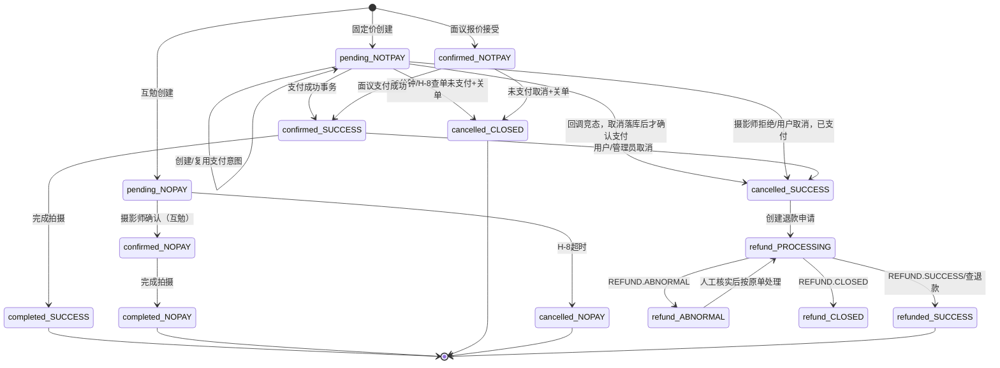

# 微信支付与订单状态机整合设计

> 范围：只做设计，不改生产代码。目标是以最小改动接入普通商户直连的小程序支付，并保持预约履约状态与资金状态分离。

## 1. 结论与边界

- `bookings.status` 继续只表示履约：`pending -> confirmed -> completed`，以及 `pending/confirmed -> cancelled`。
- 不向 `bookings` 增加 `paid`、`refund_status` 等资金列；新增支付聚合表，避免一个预约多次支付、部分退款、退款异常和对账事实被压缩成几个布尔值。
- 固定价订单和“报价已接受”的面议订单允许支付；互勉订单不创建支付单。
- 首期全额预付，金额在支付边界转换为整数分；支付成功由服务端事务把可支付的 `pending` 预约确认，面议订单已经由报价接受事务确认时只补记支付成功。
- `PAYMENT_ENABLED`（建议环境变量名同时兼容现有调研中的 `WX_PAY_ENABLED`）默认 `false`；关闭时不注册真实支付入口、不接收真实回调，保留旧订单流程。
- 取消预约与退款是两个事实：取消已支付订单创建退款任务，只有微信退款成功通知/查退款后才展示“已退款”。

## 2. 现状依据与受影响文件

### 已存在代码

- `comic/server/internal/service/booking_service.go:75-84` 定义履约转移；当前 `pending` 可到 `confirmed/cancelled`，`confirmed` 可到 `completed/cancelled`。
- `comic/server/internal/service/booking_service.go:317-370` 的 `UpdateStatus` 当前先 `GetBookingByID`，再权限/转移判断，最后调用 `UpdateBookingStatus`；读判写之间存在竞态，支付接入不能继续依赖该边界。
- `comic/server/internal/service/booking_service.go:382-414` 的 `AdminUpdateStatus` 复用同样的读判写模式，管理员取消也必须纳入退款事务。
- `comic/server/internal/service/booking_service.go:453-479` 的报价接受路径由 SQL 原子地设置 `price_status='agreed'`、`status='confirmed'`，但支付接入后“confirmed”只表示履约确认，仍要求支付成功才能 `completed`。
- `comic/server/internal/repository/models.go:114-132` 的 `Booking` 没有支付字段，保持不变。
- `comic/server/migrations/000001_create_tables.up.sql:99-112` 创建 `bookings`，`total_price INTEGER NOT NULL`；历史金额单位必须在上线前用样本确认。
- `comic/server/migrations/000029_integrity_constraints.up.sql:13-15` 已用部分唯一索引 `uniq_bookings_active_slot` 保证未取消订单档期唯一；支付迁移不得破坏该约束。
- `comic/server/internal/config/config.go:10-25,40-72` 是配置入口；需增加开关和支付配置，但密钥值只从环境/密钥挂载读取。
- `comic/server/cmd/api/main.go:130-133,170-177` 创建查询、BookingService 并注册 booking 路由；支付服务和回调路由应在此处以开关控制注册。
- `comic/server/internal/repository/bookings.sql.go:157-170` 当前 `UpdateBookingStatus` 无条件按 id 更新；应新增带状态条件的 SQL，禁止删除旧查询前直接改行为。

### 计划新增/修改文件

- 新增 `comic/server/migrations/000033_payment_orders.up.sql` 与 `.down.sql`：支付、退款、通知去重、outbox 基础表及索引。
- 新增 `comic/server/internal/repository/payment_orders.sql.go`、`payment_refunds.sql.go`、`wechat_notifications.sql.go`、`payment_outbox.sql.go`（或按现有 sqlc 生成约定拆分）；提供锁定、条件更新、幂等插入操作。
- 新增 `comic/server/internal/service/payment_service.go`：下单、通知入账、关单、退款申请和查退款的领域事务。
- 新增 `comic/server/internal/handler/payment_handler.go`：付款、查询、微信支付/退款通知入口。
- 修改 `comic/server/internal/service/booking_service.go`：取消、完成、报价接受调用支付域服务；所有状态转移改成同一事务内的条件更新。
- 修改 `comic/server/internal/repository/bookings.sql.go`：增加 `...WHERE id=$1 AND status=$2` 的条件更新或显式 `FOR UPDATE` 查询。
- 修改 `comic/server/internal/config/config.go`、`comic/server/cmd/api/main.go`：开关、支付配置、服务/路由注入。
- 新增对应 `comic/server/internal/service/payment_service_test.go`、`payment_concurrency_test.go` 和 PostgreSQL 集成测试；无正式商户号时使用 fake gateway，不伪造生产支付成功。

## 3. 数据模型

### 3.1 为什么新增支付表

给 `bookings` 加一组支付列只能表达单次付款，无法可靠表达微信商户单号、重复通知、部分退款、退款异常、多个退款申请、通知原文和对账差异；并且会让履约状态和资金状态互相覆盖。采用 `payment_orders` 一对一关联预约，`payment_refunds` 一对多关联支付单，通知和 outbox 单独持久化。

一个预约最多一个“有效支付主单”由部分唯一索引保证；重试下单复用同一个 `out_trade_no`，价格变化必须先关掉旧的 `NOTPAY` 单再生成新的支付意图。

### 3.2 字段与约束

`payment_orders`：

- `id BIGSERIAL PRIMARY KEY`
- `booking_id BIGINT NOT NULL REFERENCES bookings(id)`
- `payer_user_id BIGINT NOT NULL REFERENCES users(id)`
- `appid VARCHAR(64) NOT NULL`、`mchid VARCHAR(32) NOT NULL`
- `out_trade_no VARCHAR(32) NOT NULL UNIQUE`
- `amount_fen BIGINT NOT NULL CHECK (amount_fen > 0)`，创建后不可修改
- `description_snapshot VARCHAR(127) NOT NULL`
- `status VARCHAR(16) NOT NULL DEFAULT 'NOTPAY' CHECK (status IN ('NOTPAY','SUCCESS','CLOSED'))`
- `transaction_id VARCHAR(64) UNIQUE`、`payer_openid VARCHAR(128)`、`success_time TIMESTAMPTZ`、`raw_trade_state VARCHAR(32)`
- `prepay_id` 可选且不作为资金事实，`created_at/updated_at`

约束：`UNIQUE(booking_id)`（初期严格一预约一主单）；`UNIQUE(out_trade_no)`；`UNIQUE(transaction_id)`；索引 `(payer_user_id, created_at DESC)`、`(status, updated_at)`。若未来允许重新定价并保留历史支付意图，将 `booking_id` 改为普通索引并增加 `UNIQUE(booking_id) WHERE status IN ('NOTPAY','SUCCESS')`，本期不做。

`payment_refunds`：

- `id BIGSERIAL PRIMARY KEY`、`payment_order_id BIGINT NOT NULL REFERENCES payment_orders(id)`
- `out_refund_no VARCHAR(64) NOT NULL UNIQUE`、`refund_id VARCHAR(64) UNIQUE`
- `amount_fen BIGINT NOT NULL CHECK (amount_fen > 0)`、`reason VARCHAR(80)`
- `status VARCHAR(16) NOT NULL DEFAULT 'PROCESSING' CHECK (status IN ('PROCESSING','SUCCESS','ABNORMAL','CLOSED'))`
- `operator_admin_id BIGINT REFERENCES admins(id)`、`success_time`、`created_at/updated_at`
- 索引 `(payment_order_id, status)`；业务事务锁支付单并校验成功/处理中退款累计不超过实付。

`wechat_notifications`：保存 `notification_id VARCHAR(64) UNIQUE`、`event_type`、`resource_type`、四个签名头的元数据、原始 ciphertext、`processed_at`、`processing_result`、`created_at`；不要把解密后的 openid/密钥写普通日志。重复通知凭唯一键返回成功，不重复入账。

`payment_outbox`：`event_id UUID/UUID-like UNIQUE`、`aggregate_type`、`aggregate_id`、`event_type`、JSON payload、`published_at`、`retry_count`、`created_at`；与支付成功/退款成功/取消待退款事实同事务写入，异步发送通知、发货管理或补偿任务。

### 3.3 迁移 SQL 草案

文件：`comic/server/migrations/000033_payment_orders.up.sql`

```sql
BEGIN;

CREATE TABLE payment_orders (
  id BIGSERIAL PRIMARY KEY,
  booking_id BIGINT NOT NULL REFERENCES bookings(id),
  payer_user_id BIGINT NOT NULL REFERENCES users(id),
  appid VARCHAR(64) NOT NULL,
  mchid VARCHAR(32) NOT NULL,
  out_trade_no VARCHAR(32) NOT NULL UNIQUE,
  amount_fen BIGINT NOT NULL CHECK (amount_fen > 0),
  description_snapshot VARCHAR(127) NOT NULL,
  status VARCHAR(16) NOT NULL DEFAULT 'NOTPAY'
    CHECK (status IN ('NOTPAY','SUCCESS','CLOSED')),
  transaction_id VARCHAR(64) UNIQUE,
  payer_openid VARCHAR(128),
  prepay_id VARCHAR(128),
  success_time TIMESTAMPTZ,
  raw_trade_state VARCHAR(32),
  created_at TIMESTAMPTZ NOT NULL DEFAULT NOW(),
  updated_at TIMESTAMPTZ NOT NULL DEFAULT NOW(),
  CONSTRAINT uniq_payment_order_booking UNIQUE (booking_id)
);
CREATE INDEX idx_payment_orders_payer_created
  ON payment_orders (payer_user_id, created_at DESC);
CREATE INDEX idx_payment_orders_status_updated
  ON payment_orders (status, updated_at);

CREATE TABLE payment_refunds (
  id BIGSERIAL PRIMARY KEY,
  payment_order_id BIGINT NOT NULL REFERENCES payment_orders(id),
  out_refund_no VARCHAR(64) NOT NULL UNIQUE,
  refund_id VARCHAR(64) UNIQUE,
  amount_fen BIGINT NOT NULL CHECK (amount_fen > 0),
  reason VARCHAR(80),
  status VARCHAR(16) NOT NULL DEFAULT 'PROCESSING'
    CHECK (status IN ('PROCESSING','SUCCESS','ABNORMAL','CLOSED')),
  operator_admin_id BIGINT REFERENCES admins(id),
  success_time TIMESTAMPTZ,
  created_at TIMESTAMPTZ NOT NULL DEFAULT NOW(),
  updated_at TIMESTAMPTZ NOT NULL DEFAULT NOW()
);
CREATE INDEX idx_payment_refunds_order_status
  ON payment_refunds (payment_order_id, status);

CREATE TABLE wechat_notifications (
  notification_id VARCHAR(64) PRIMARY KEY,
  event_type VARCHAR(64) NOT NULL,
  resource_type VARCHAR(32) NOT NULL,
  headers_metadata JSONB NOT NULL,
  ciphertext_payload TEXT NOT NULL,
  processed_at TIMESTAMPTZ,
  processing_result VARCHAR(32),
  created_at TIMESTAMPTZ NOT NULL DEFAULT NOW()
);

CREATE TABLE payment_outbox (
  event_id UUID PRIMARY KEY,
  aggregate_type VARCHAR(32) NOT NULL,
  aggregate_id BIGINT NOT NULL,
  event_type VARCHAR(64) NOT NULL,
  payload JSONB NOT NULL,
  published_at TIMESTAMPTZ,
  retry_count INTEGER NOT NULL DEFAULT 0,
  created_at TIMESTAMPTZ NOT NULL DEFAULT NOW()
);
CREATE INDEX idx_payment_outbox_pending
  ON payment_outbox (created_at) WHERE published_at IS NULL;

COMMIT;
```

文件：`comic/server/migrations/000033_payment_orders.down.sql`

```sql
BEGIN;
DROP TABLE IF EXISTS payment_outbox;
DROP TABLE IF EXISTS wechat_notifications;
DROP TABLE IF EXISTS payment_refunds;
DROP TABLE IF EXISTS payment_orders;
COMMIT;
```

迁移前必须检查存量 `bookings.total_price` 单位和 `users/admins` 外键可用性；迁移只建空表，不改历史订单，不回填“已支付”。若历史线下已收款，另做人工导入迁移，必须带审计来源，不能猜测为微信成功。

## 4. 状态机与业务规则

### 4.1 预约与支付组合

- 固定价 `pending + NOTPAY`：允许下单；支付成功事务锁 payment 与 booking，核对金额后将预约 `pending -> confirmed`。
- 面议：报价接受仍将 `price_status=agreed`、`status=confirmed`，但只有 `confirmed + NOTPAY` 允许付款；成功回调只更新支付单，不重复写 confirmed。
- `confirmed + NOTPAY` 的面议单不能 `completed`；固定价也不能 `completed`，除非存在 `payment_orders.status='SUCCESS'`。
- 互勉不出现 payment order。

### 4.2 摄影师拒绝、取消和退款

当前摄影师拒绝通过 `pending -> cancelled` 表达；如果该预约已有 `SUCCESS` 支付，取消事务必须同时创建稳定 `out_refund_no` 的退款记录并写 `REFUND_REQUESTED` outbox，随后调用微信退款 API。退款 API 返回“已受理”只置 `PROCESSING`，最终由退款通知/查退款置 `SUCCESS`、`ABNORMAL` 或 `CLOSED`。

取消规则：

- 未支付 `NOTPAY`：先微信关单（超时/失败可查单），条件更新支付单为 `CLOSED`，再取消 booking；无退款单。
- 已支付 `SUCCESS`：booking 进入 `cancelled`，资金仍为 `SUCCESS`，创建全额或按已拍摄规则计算的退款申请；本期默认全额，具体比例由产品规则冻结。
- 取消与支付回调并发：同一事务锁 payment row 再锁 booking row；若回调先成功则取消生成退款；若取消先落库，回调仍必须记支付成功并生成“已付已取消待退款”，绝不把 SUCCESS 改成 NOTPAY 或丢弃回调。
- 摄影师拒绝已支付订单按“已支付取消”处理，自动全额退款；退款异常进入人工队列，不通过换 `out_refund_no` 无限重试。

### 4.3 两类超时统一

- 支付窗口建议 30 分钟：任务按 `payment_orders.status=NOTPAY AND created_at < now()-30m` 锁单，先查单；微信仍未支付则调用关单，条件关闭支付单，再以条件更新 `bookings.pending -> cancelled`，释放 `uniq_bookings_active_slot`。
- 现有 H-8 pending 超时适用于未被确认的预约。统一为同一个“过期协调器”：先按支付事实分支：`NOTPAY` 走关单+取消；`SUCCESS` 不取消且补确认/进入异常；无支付（互勉）按现有 H-8 规则取消。H-8 不能直接把已支付预约改 cancelled。
- 任务和回调都使用相同的 `ReconcilePaymentAndBooking` 领域函数，幂等执行；微信 `time_expire`/prepay_id 到期不是业务取消依据。

### 4.4 Mermaid 状态图



图中 `booking.status` 和支付状态是两个维度；组合状态只用于展示和动作判断，不能把 `cancelled` 映射成“已退款”。

## 5. 幂等、一致性与并发

### 5.1 商户单号

格式建议 `PAY_<bookingID>_<attempt>`，例如 `PAY_123_01`，保证长度 6-32、仅字母数字下划线；固定价首次创建 attempt=01，网络超时重试复用原号。只有旧单已确认 `CLOSED` 且金额/付款人改变时才递增 attempt；在本期 `UNIQUE(booking_id)` 约束下，需先将旧意图关闭并通过审计记录新意图，后续若放宽为多意图再调整表约束。退款号建议 `RF_<paymentOrderID>_<refundAttempt>`，同一业务取消重试复用原号。

### 5.2 回调幂等

1. 读取原始 body 和 `Wechatpay-*` 头；先 RSA-SHA256 验签，再 APIv3 AES-256-GCM 解密。
2. 校验 `appid/mchid/out_trade_no/transaction_id/openid/trade_state`，并严格要求解密后的 `amount.total == payment_orders.amount_fen == booking 应付金额`；任何金额、币种、归属不符均不入账并返回非 2xx。
3. 在一个 PostgreSQL 事务中 `INSERT INTO wechat_notifications ... ON CONFLICT DO NOTHING`；已处理通知直接 200。新通知 `SELECT payment_orders ... FOR UPDATE`，再 `SELECT bookings ... FOR UPDATE`。
4. 仅允许 `NOTPAY -> SUCCESS`；重复 SUCCESS 为幂等成功；不允许 SUCCESS 回退 CLOSED。更新支付事实、必要的 booking 条件迁移、outbox 同事务提交。
5. 事务提交后尽快返回 200/204；不在回调事务里请求微信、发通知或执行慢任务。数据库失败返回非 2xx 让微信重试。

### 5.3 修复现有 UpdateStatus 竞态

不能仅在 Go 中 `GetBookingByID` 后再判断。新增事务函数必须：

- 用 `SELECT ... FOR UPDATE` 锁 booking，再锁相关 payment order（统一锁顺序，所有路径都 payment -> booking，避免死锁）。
- 权限检查可在锁前完成，但最终转移必须 `UPDATE bookings SET status=$to WHERE id=$id AND status=$from RETURNING ...`，RowsAffected=0 映射 409 并重新读取事实。
- 支付回调、取消、完成、管理员取消、H-8 过期、报价接受都走领域协调器；禁止旧 `UpdateBookingStatus` 无条件覆盖支付触发的结果。
- 事务只写事实和 outbox；外部微信 API 放事务外。下单网络超时先按相同 `out_trade_no` 查单，不盲目换号。

## 6. 迁移、灰度与回滚

1. `000033_payment_orders`：建支付/退款/通知/outbox 表和索引，先部署到所有实例；旧实例看不见新表也不受影响，迁移 up 可重复执行。
2. 第二阶段部署代码但 `PAYMENT_ENABLED=false`：注册只读查询和 fake gateway；真实支付下单、退款、回调写入均关闭或回调返回非成功并告警，避免误收真实通知。
3. 第三阶段小流量打开：固定价订单先启用，观察唯一约束、通知积压、金额差异和退款异常，再启用面议；开关按实例/环境注入，不能由客户端传入。
4. 回滚代码：先关闭开关，等待 NOTPAY 补偿任务清空；保留支付表和事实，回滚应用版本不删除表。若已存在 SUCCESS/退款事实，禁止执行 down。
5. 只有确认无支付表数据、无外部账务引用且停写后，维护窗口才允许执行 `000033_payment_orders.down.sql`；正常发布回滚只回滚应用，不回滚迁移。历史 bookings 履约状态保持可读。

## 7. 安全要求

- `WX_APP_SECRET`、商户 API 私钥、APIv3 密钥、微信支付公钥只放受限环境变量/密钥挂载（建议 Docker secret/KMS），不进 Git、镜像、数据库业务字段、小程序包、管理 API 响应。
- 日志只记录 `booking_id`、脱敏 `out_trade_no`/`transaction_id`、微信 `Request-ID`、事件类型和结果；openid 只显示前后少量字符或哈希，原始 ciphertext 不打日志。支付表和通知表限制管理员/财务读取。
- 验签失败、serial 不识别、时间戳超窗、GCM 解密失败、mchid/AppID/openid/金额不匹配均不更新任何支付或 booking 状态，返回非 2xx；记录安全告警和失败原因分类，不能为方便重试而返回 200。
- 回调通知 URL 不挂用户登录中间件，验证依据是微信签名；内部支付查询和退款接口继续走用户/管理员鉴权。
- amount 使用整数分和 `BIGINT`，不使用浮点；服务端从 booking 快照计算金额，忽略客户端 amount/openid；支付成功前金额不可修改。
- 退款累计金额在锁定 payment order 的事务中检查，成功/处理中合计不得超过实付；每次退款记录操作员、原因、原支付单和通知 ID。

## 8. 验收清单

- 双击付款只产生一个 `out_trade_no`；下单超时复用单号并查单。
- 回调正确入账；错签名、错密钥、改原始 body、错 AppID/mchid/openid/金额均不入账。
- 同一通知并发 20 次只产生一个 SUCCESS；重复通知返回成功但无重复 outbox。
- 摄影师拒绝/用户取消已支付订单自动创建一笔全额退款，退款成功前展示处理中；退款异常进入人工队列。
- 未支付 30 分钟与 H-8 都经统一协调器关单并取消；已支付订单不会被超时任务取消。
- `confirmed`/`completed` 竞态、管理员取消、回调与取消并发不会丢支付事实或覆盖终态。
- 固定价/面议未支付不能 `completed`；互勉始终不创建支付单。
- 无正式商户号时 fake gateway 使用相同领域服务；PostgreSQL 集成测试覆盖锁、唯一键、条件更新和通知幂等；仿真成功不污染生产支付配置。

## 9. 待产品冻结

上线前必须确认：`bookings.total_price` 当前单位、固定价/面议是否全额预付、30 分钟支付窗口、H-8 的准确时长、摄影师拒绝和各取消时点退款比例、平台收款与摄影师结算主体、小程序 AppID 与商户主体绑定关系。未冻结前可以做 schema/fake 测试，不开启真实支付。
